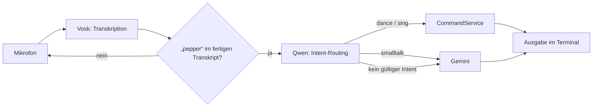

# IOT Pepper

Python-Prototyp für eine sprachgesteuerte Interaktion mit dem Roboter Pepper. Das Programm nimmt Mikrofon-Audio auf, transkribiert Sprache lokal mit Vosk, erkennt das Aktivierungswort `pepper` und wählt mit einem lokalen Qwen-Modell zwischen den Intents `dance`, `sing` und `smalltalk`. Für Smalltalk wird die Gemini-API aufgerufen.

**Projektstand:** Die Hauptanwendung zeigt Transkripte und Antworten im Terminal an. Die Aktionen `dance` und `sing` sind Text-Platzhalter. Ein SSH-Dienst für Pepper ist vorhanden, wird im Hauptablauf aber nicht für Sprachausgabe oder Bewegungen verwendet. Das Projekt ist ein Prototyp, keine fertig integrierte Robotersteuerung.

## Funktionsumfang

- Fortlaufende Aufnahme von Mikrofon-Audio und lokale deutsche Transkription mit Vosk.
- Aktivierung durch das erkannte Wort `pepper` in einem abgeschlossenen Transkript.
- Lokale Intent-Auswahl mit Qwen für `dance`, `sing` oder `smalltalk`.
- Textantworten für Befehle und Gemini-Antworten für Smalltalk oder unbekannte Intents.
- Optionaler SSH-Dienst mit Methoden für Sprachausgabe und Winken; noch nicht in den Hauptablauf eingebunden.

## Voraussetzungen

- Python 3.12 und `pip` (die festgelegte Version `torch==2.3.1` bietet Wheels bis Python 3.12; siehe [PyPI](https://pypi.org/project/torch/2.3.1/)).
- Ein funktionierendes Mikrofon und Zugriff darauf über `sounddevice`.
- Ein lokal entpacktes deutsches Vosk-Modell und ein lokal gespeichertes Qwen2.5-0.5B-Instruct-Modell.
- Ein Gemini-API-Schlüssel in der Umgebungsvariable `GEMINI_API_KEY` — auch wenn nur lokale Befehle ausprobiert werden, da der Dienst beim Start initialisiert wird.
- Optional: SSH-Zugang zu einem Pepper-Roboter. Ohne ihn läuft der Hauptablauf mit Konsolenausgabe.

## Schnellstart

Die folgenden Befehle werden im Projektverzeichnis ausgeführt. Beispiel für PowerShell:

```powershell
py -3.12 -m venv .venv
.\.venv\Scripts\python.exe -m pip install -r requirements.txt
$env:GEMINI_API_KEY = "DEIN_API_SCHLUESSEL"
```

Unter Linux oder macOS entsprechend `python3.12 -m venv .venv`, `.venv/bin/python -m pip install -r requirements.txt` und `export GEMINI_API_KEY=...` verwenden. Der Eintrag für PyTorch in `requirements.txt` nutzt den CPU-Paketindex; die Anwendung lädt Qwen ebenfalls auf der CPU.

### Optionaler Pepper-Zugang

Für eine SSH-Verbindung kann der Host samt Zugangsdaten über Umgebungsvariablen gesetzt werden. Ohne `PEPPER_SSH_HOST` startet die Anwendung ohne SSH-Verbindung. Auch mit Verbindung gibt der Hauptablauf Antworten derzeit nur im Terminal aus.

```powershell
$env:PEPPER_SSH_HOST = "ROBOTER_IP"
$env:PEPPER_SSH_USERNAME = "BENUTZERNAME"
$env:PEPPER_SSH_PASSWORD = "PASSWORT"  # alternativ: PEPPER_SSH_KEY_FILE
```

### Modelle ablegen

Die Verzeichnisse müssen **genau** zu den Pfaden in `main.py` passen:

```text
models/
├── vosk-model-small-de-0.15/
│   ├── am/
│   ├── conf/
│   ├── graph/
│   └── ivector/
└── qwen2_5-0_5b_instruct/
    ├── config.json
    ├── tokenizer.json
    └── model.safetensors  # oder die vom Modell bereitgestellten Gewichtsdateien
```

Das Vosk-Modell ist auf der [offiziellen Vosk-Modellseite](https://alphacephei.com/vosk/models) als `vosk-model-small-de-0.15` aufgeführt. Das Qwen-Modell steht auf [Hugging Face](https://huggingface.co/Qwen/Qwen2.5-0.5B-Instruct). Für Qwen müssen alle zum Modell gehörenden Konfigurations-, Tokenizer- und Gewichtsdateien im angegebenen Ordner liegen. `IntentRouterService` lädt diese Dateien mit `local_files_only=True`; er lädt sie nicht beim Programmstart herunter.

**Wichtig beim Klonen:** Die Modelle sind nicht im Repository enthalten; `models/` ist in `.gitignore` eingetragen. Nach jedem Clone sind beide Modellverzeichnisse lokal mit den jeweiligen Dateien zu befüllen.

### Anwendung starten

```powershell
.\.venv\Scripts\python.exe main.py
```

Das Programm lauscht fortlaufend. Nach einem abgeschlossenen Vosk-Transkript mit `pepper` bestimmt Qwen einen Intent. Beispiele für Spracheingaben sind „Pepper, tanz“, „Pepper, sing“ und „Pepper, erzähl mir etwas“. Antworten erscheinen als `Pepper sagt: ...` im Terminal. Mit `Strg+C` wird die Schleife beendet.

## Ablauf



Vosk verarbeitet Audio mit 16 kHz in Aufnahmen von 0,5 Sekunden. Der Hauptablauf behält ungefähr zehn Sekunden Audio in einem Puffer und bis zu acht fertige Transkript-Fragmente. Die Erkennung läuft direkt über die Audio-Chunks; der Zehn-Sekunden-Puffer wird derzeit nicht erneut transkribiert. Teiltranskripte werden angezeigt, lösen aber keine Aktion aus. Nach einer Aktivierung werden Erkenner, Puffer und Textfragmente zurückgesetzt.

Weitere technische Details und die Zuständigkeit der Klassen stehen in [docs/ARCHITEKTUR.md](docs/ARCHITEKTUR.md).

## Technologien

| Baustein | Verwendung |
| --- | --- |
| Python | Hauptanwendung und Dienste |
| Vosk und `sounddevice` | Lokale Spracherkennung und Mikrofonaufnahme |
| Qwen2.5-0.5B-Instruct, `transformers` und PyTorch | Lokales Intent-Routing auf der CPU |
| Google Gemini (`google-genai`) | Generierung von Smalltalk-Antworten |
| Spur / SSH | Optionale Verbindung zum Pepper-Roboter |

## Projektstruktur

| Pfad | Aufgabe |
| --- | --- |
| `main.py` | Initialisierung, Aufnahme-Schleife, Aktivierungswort und Intent-Ausführung |
| `services/audioprocessor/AudioProcessorService.py` | Aufnahme über Mikrofon und gemeinsame Audio-Schnittstelle |
| `services/audioprocessor/VoskServiceImpl.py` | Lokale Transkription und Streaming-Erkenner |
| `services/audioprocessor/CheckCommandService.py` | Platzhalter für Tanzen und Singen; enthält zusätzlich eine aktuell ungenutzte Regex-Erkennung |
| `services/intent/IntentRouterService.py` | Lokales Qwen-Modell, JSON-Intent-Auswahl und Handler-Aufruf |
| `services/chatbot/GeminiServiceImpl.py` | Antwortgenerierung über die Gemini-API |
| `services/sshservice/SSHService.py` | SSH-Verbindung sowie Methoden für Sprechen und Winken |
| `services/audioprocessor/WhisperServiceImpl.py` | Alternative Transkriptionsklasse; nicht im Hauptablauf eingebunden |

## Tests und Prüfungen

Ein automatisierter Testlauf ist derzeit nicht eingerichtet. Eine reine Syntaxprüfung ist mit `python -m py_compile main.py` möglich. Für einen Funktionstest werden beide lokalen Modelle, ein Mikrofon und ein Gemini-API-Schlüssel benötigt; die SSH-Funktionen erfordern zusätzlich einen erreichbaren Pepper-Roboter.

## Aktuelle Grenzen

- `dance` und `sing` geben nur Text zurück. Die Methoden `execute_talk()` und `execute_wave()` im SSH-Dienst sind nicht mit den Intent-Handlern verbunden.
- Ohne `PEPPER_SSH_HOST` wird keine SSH-Verbindung aufgebaut. Zugangsdaten werden aus `PEPPER_SSH_USERNAME`, `PEPPER_SSH_PASSWORD` oder `PEPPER_SSH_KEY_FILE` gelesen. Der SSH-Dienst akzeptiert derzeit bislang unbekannte Host-Schlüssel.
- `SSHService.execute_talk()` setzt den Text direkt in einen Shell-Befehl ein. Vor der Übergabe frei formulierter Antworten an Pepper ist eine sichere Übergabe des Texts erforderlich.
- `GeminiServiceImpl` gibt bei einem Fehler derzeit schon nach dem ersten Versuch `Exception gefangen` zurück. Der vorgesehene Wiederholungsversuch wird dadurch nicht ausgeführt.
- Die Python-Abhängigkeiten außer `torch` sind nicht auf Versionen festgelegt. Die Installation kann daher mit späteren Paketversionen anders ausfallen. Ein automatisierter End-to-End-Test und eine CI-Konfiguration sind nicht vorhanden.
- `WhisperServiceImpl` benötigt ein bereits initialisiertes externes Modell; eine passende Whisper-Abhängigkeit ist nicht in `requirements.txt` eingetragen.
